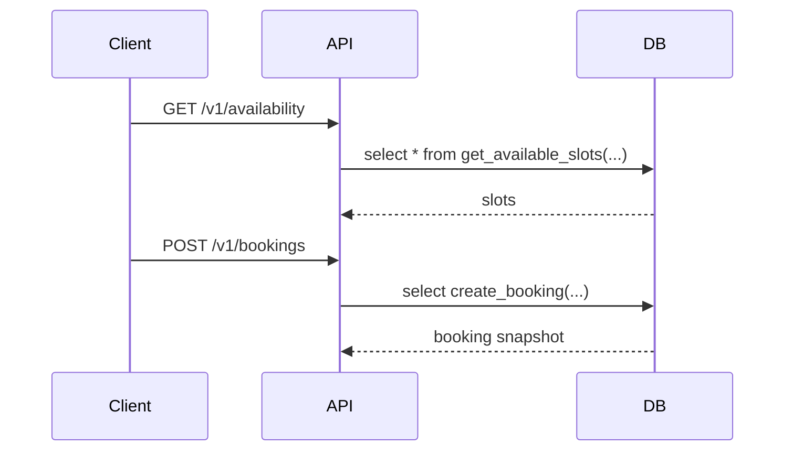
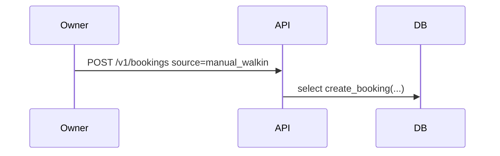
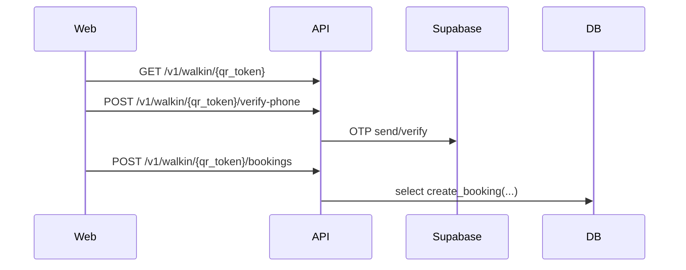

# Booking Flow

Booking implementation is intentionally not migrated in Phase 1.

Required Phase 4 rules:

- Availability delegates to `get_available_slots`.
- Booking creation delegates to `create_booking`.
- The API must not insert directly into `bookings` or `booking_services`.
- `booking_services` rows are immutable snapshots from the database function.
- `SlotUnavailableError` maps to HTTP `409`.

## Customer App

## Manual Walk-in

## QR Walk-in

