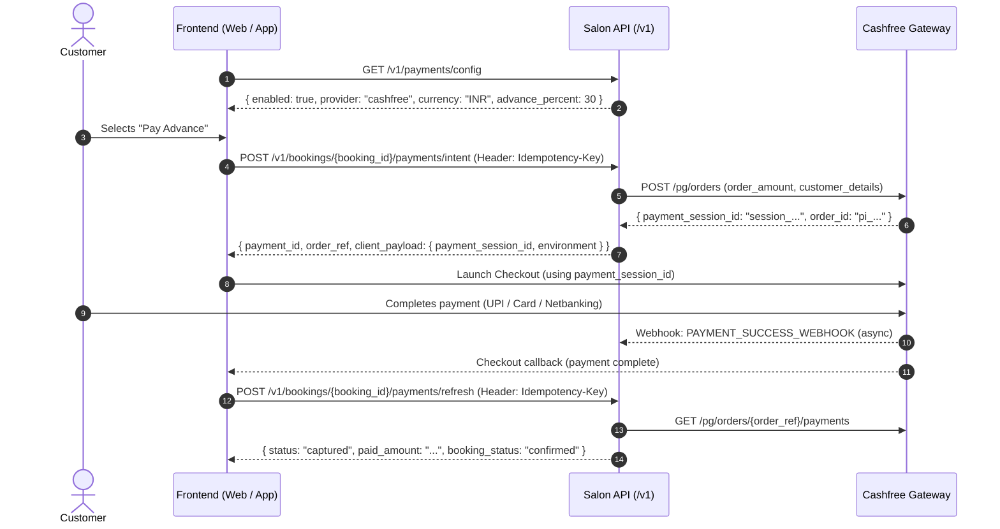

# Frontend integration

Canonical production API origin: `https://api.salones.in` (27 October 2026).
Website server `API_BASE_URL` and both mobile apps' `EXPO_PUBLIC_API_URL` use this
origin without `/v1`; existing adapters supply the versioned path. Swagger is
`https://api.salones.in/docs`. The old hostname remains available for legacy
installed builds. See the [migration receipt](../backend/docs/verification/API_DOMAIN_MIGRATION_2026-10-27.md)
for deployment identities, verification, rollback and mobile-install boundaries.

The new checkout/support contract is documented in
[PRODUCTION_VERIFICATION.md](../backend/docs/PRODUCTION_VERIFICATION.md). Separate clients must
adopt server quote totals, disabled-online-payment state, Pay at Salon instructions, typed
409 errors, `cash|upi_direct` collection and owner access-wall fields. Collection and completion
accept `Idempotency-Key`; booking creation persists replay in Postgres. Existing bookings remain
accessible after subscription/trial expiry. Native/browser verification has outstanding failures;
see [current evidence](../backend/docs/verification/checkout-results.md).

Frontend applications use an environment-specific API base URL and send JSON unless an
endpoint documents multipart upload.

Protected requests include the Supabase access token:

```http
Authorization: Bearer <access-token>
```

The backend verifies the token signature and resolves its `sub` against `profiles`.
Clients must not rely on role claims embedded in the JWT.

Useful entry points:

- `GET /health` for process health
- `GET /health/db` for database health
- `/docs` for the current OpenAPI/Swagger contract
- `/v1/auth/*` for session and actor operations
- `/v1/salons*` and `/v1/availability` for public discovery
- `/v1/bookings*` for authenticated booking operations
- `/v1/walkin/*` for the QR flow

Clients should handle `401`, `403`, `404`, `409`, and validation errors explicitly.
Service responses include nullable `photo_url` and salon-specific category names;
group service cards by the returned names and use the default service image when
the photo is null. See the [service presentation handover](../backend/docs/SERVICE_PRESENTATION.md)
for PATCH semantics, media rules, and the customer parser/rendering changes.
On a booking conflict, refresh availability before asking the user to choose another
slot.

Discovery uses `GET /v1/salons?surface=home` for the home feed and `surface=search`
for search screens. Keep `shuffle_seed` stable across a paginated view. Visibility
and placement are enforced before pagination; do not reorder client-side.
QR websites resolve their route token through `/v1/walkin/{token}?fresh=true`
and use returned salon/staff/services rather than the signed-in owner's salon.
See the [website implementation prompt](../backend/docs/WEBSITE_SUPERADMIN_PROMPT.md).

Never place the Supabase service-role key, database URL, R2 secret, or Firebase service
account in a frontend environment.

## Account deletion contract (customer app, owner app, website)

All three call the same endpoints with the user's bearer token; never send a user id or role.

1. `POST /v1/account/deletion/challenges` `{channel: "email"|"phone", contact?}` -> 202
   `{challenge_id, masked_destination, expires_at, resend_available_at, bookings_to_cancel}`.
   `bookings_to_cancel` is the number of upcoming bookings that confirming an **owner**
   deletion will cancel (always 0 for customers): show it in the warning.
2. `POST /v1/account/deletion/challenges/{challenge_id}/verify` `{code}` -> 200
   `{confirmation_token, expires_at}` (nothing is deleted yet).
3. `POST /v1/account/deletion` `{challenge_id, confirmation_token, confirm: "DELETE"}` -> 202
   `{request_id, status, status_token}`. Show an irreversible-action warning first. Afterwards
   the bearer token is rejected (401): sign the user out locally.
4. `GET /v1/account/deletion/{request_id}` with header `X-Status-Token: <status_token>` -> 200
   `{status: pending|processing|completed|failed, stage: queued|refunding|waiting_for_refunds|
   erasing|completed, requested_at, completed_at}`. `failed` means a retry is scheduled; the
   account stays locked. An owner may sit in `pending` / `waiting_for_refunds` for a while
   (refunds settling) - that is normal, not a failure.

Errors use the standard envelope. Handle `deletion_blocked` (409). **Customers**: tell them
to cancel their upcoming bookings / resolve pending requests (`details.open_bookings`,
`details.pending_requests`). **Owners are no longer blocked by open bookings or requests**
- they are cancelled and refunded by the backend; an owner is blocked only by an active paid
subscription (`details.active_subscriptions`). Also handle `contact_mismatch` (422),
`invalid_verification_code` (400), and 429 (honor `resend_available_at`). Customers whose
booking is cancelled because the salon closed receive a `booking_cancelled` notification
(`data.reason = "salon_closed"`) and the booking has `cancellation_reason = "salon_closed"`.
Details: `backend/docs/ACCOUNT_DELETION.md`.


Prepared locally: category-based staff menus, bulk services and consecutive multi-staff visits
are documented in [the visit contract](../backend/docs/STAFF_SERVICE_VISITS.md). Migration/release approval and native acceptance remain separate.

---

## Cashfree Online Payments Contract (customer-app, salon-QR-walking-web)

The backend has active Cashfree Payment Gateway support (`PAYMENT_PROVIDER=cashfree`) running in Standard Payment Gateway mode (`CASHFREE_EASY_SPLIT_ENABLED=false`).

### 1. Completed Backend Capabilities
- **Gateway Adapter**: [`backend/app/infrastructure/payments/cashfree.py`](file:///d:/salon/salon-backend/backend/app/infrastructure/payments/cashfree.py) handles order creation (`POST https://api.cashfree.com/pg/orders`), server-side verification (`GET /orders/{order_id}/payments`), and refunds.
- **Webhook Processing**: `POST /v1/webhooks/cashfree` verifies incoming HMAC-SHA256 signatures over `timestamp + raw_body` and updates booking payment states idempotently in the background.
- **Exact Accounting**: All calculations use Python `Decimal` (never `float`), enforcing exact paise matching. Client-side payment callbacks are never trusted alone; verification requires server-to-server confirmation.
- **Security Verified**: Zero vulnerabilities across all 18 security controls (no secret leaks, no client amount tampering, constant-time signature comparison, replay protection).

---

### 2. Frontend Client Integration Flow



---

### 3. API Endpoints Specification

#### A. Check Provider Status: `GET /v1/payments/config`
Check whether online advance payment is available before displaying the "Pay Online / Pay Advance" option.

- **Request**: `GET /v1/payments/config` (Public or with Bearer token)
- **Response** (`200 OK`):
  ```json
  {
    "enabled": true,
    "online_payment_available": true,
    "provider": "cashfree",
    "public_key": null,
    "currency": "INR",
    "advance_percent": 30,
    "settlement_model": "platform_collect",
    "confirmation": "refresh"
  }
  ```

#### B. Create Payment Intent: `POST /v1/bookings/{booking_id}/payments/intent`
Initiates an order with Cashfree. The amount is derived 100% server-side based on booking total and advance percentage; clients never send monetary amounts.

- **Request**:
  - `POST /v1/bookings/{booking_id}/payments/intent`
  - **Headers**:
    ```http
    Authorization: Bearer <user_jwt_token>
    Idempotency-Key: <unique_uuid_v4>
    Content-Type: application/json
    ```
  - **Body** (optional):
    ```json
    {
      "purpose": "deposit"
    }
    ```
- **Response** (`200 OK`):
  ```json
  {
    "payment_id": "3fa85f64-5717-4562-b3fc-2c963f66afa6",
    "order_ref": "pi_1234567890abcdef1234567890abcdef",
    "status": "created",
    "amount": "150.00",
    "currency": "INR",
    "expires_at": "2026-11-11T18:00:00Z",
    "client_payload": {
      "payment_session_id": "session_xxxx...",
      "order_id": "pi_1234567890abcdef1234567890abcdef",
      "environment": "production"
    }
  }
  ```

#### C. Verify & Refresh Payment: `POST /v1/bookings/{booking_id}/payments/refresh`
Called immediately after the customer completes the Cashfree checkout modal/SDK screen. The backend queries Cashfree directly to verify that money was captured.

- **Request**:
  - `POST /v1/bookings/{booking_id}/payments/refresh`
  - **Headers**:
    ```http
    Authorization: Bearer <user_jwt_token>
    Idempotency-Key: <unique_uuid_v4>
    Content-Type: application/json
    ```
  - **Body**:
    ```json
    {
      "order_ref": "pi_1234567890abcdef1234567890abcdef"
    }
    ```
- **Response** (`200 OK`):
  ```json
  {
    "booking_id": "booking-uuid",
    "payment_state": "partially_paid",
    "paid_amount": "150.00",
    "total_price": "500.00",
    "currency": "INR",
    "payments": [
      {
        "id": "3fa85f64-5717-4562-b3fc-2c963f66afa6",
        "provider": "cashfree",
        "status": "captured",
        "amount": "150.00",
        "currency": "INR",
        "captured_at": "2026-11-11T17:55:00Z"
      }
    ]
  }
  ```

---

### 4. Client-Specific Setup Instructions

#### A. `salon-QR-walking-web` (Web / Next.js / React)
1. Install `@cashfreepayments/cashfree-js` or load the script:
   ```html
   <script src="https://sdk.cashfree.com/js/v3/cashfree.js"></script>
   ```
2. Checkout implementation:
   ```javascript
   import { load } from "@cashfreepayments/cashfree-js";

   // 1. Initialize SDK once at module or component mount
   const cashfree = await load({
     mode: intentResponse.client_payload.environment || "production",
   });

   // 2. Launch Drop-in checkout
   const result = await cashfree.checkout({
     paymentSessionId: intentResponse.client_payload.payment_session_id,
     redirectTarget: "_modal",
   });

   // 3. Handle modal close & re-verify with backend
   if (result.error) {
     console.log("Customer closed modal or encountered an error:", result.error);
   }

   // Always verify server-side upon completion:
   await api.post(`/v1/bookings/${bookingId}/payments/refresh`, {
     order_ref: intentResponse.order_ref,
   }, {
     headers: { "Idempotency-Key": generateUUID() }
   });
   ```

#### B. `customer-app` (React Native / Expo Mobile App)
1. Install `react-native-cashfree-pg-sdk`:
   ```bash
   npx expo install react-native-cashfree-pg-sdk
   ```
2. Checkout implementation:
   ```typescript
   import {
     CFEnvironment,
     CFSession,
     CFWebCheckoutPayment,
     CFPaymentGatewayService,
   } from "react-native-cashfree-pg-sdk";

   // Register callbacks
   CFPaymentGatewayService.setCallback({
     async onVerify(orderID: string) {
       // Verify with backend
       const refreshRes = await api.post(
         `/v1/bookings/${bookingId}/payments/refresh`,
         { order_ref: orderID },
         { headers: { "Idempotency-Key": generateUUID() } }
       );
       if (refreshRes.data.payments.some((p: any) => p.status === "captured")) {
         navigation.navigate("BookingConfirmed", { bookingId });
       }
     },
     onError(error: any, orderID: string) {
       console.log("Payment error or user cancelled:", error);
     },
   });

   // Launch checkout
   const env = intentResponse.client_payload.environment === "production"
     ? CFEnvironment.PRODUCTION
     : CFEnvironment.SANDBOX;

   const session = new CFSession(
     intentResponse.client_payload.payment_session_id,
     intentResponse.order_ref,
     env
   );
   const payment = new CFWebCheckoutPayment(session);
   CFPaymentGatewayService.doWebPayment(payment);
   ```

---

## Wallet and payouts: what the apps and the admin website show (migration 0068)

Collection above ends with the booking paid. This is the money's next leg. Full rules: `backend/docs/WALLET_PAYOUTS.md`.

**Owner app** (`GET /v1/salons/me/wallet`, `.../wallet/entries`): each payout entry now carries `processing: boolean`.
When `processing` is true the platform has started sending the payout: show it as "on its way", hide Cancel
(`can_cancel` is false), and expect it to become `status: "paid"` with `reference` (the bank's UTR) and `method`
(`upi` or `imps`). `POST .../payout-requests/{id}/cancel` answers `transfer_in_progress` (409) in that window. An older
backend omits `processing`; treat it as false.

**Admin website** (super admin, MFA), per waiting payout request, one of:
- `POST /v1/admin/wallet/payout-requests/{id}/mark-paid` (multipart, with proof): pay by hand, as before.
- `POST /v1/admin/wallet/payout-requests/{id}/send-transfer` (202, no body): returns the payout detail with
  `processing` and a `transfer` block (`status`: `pending` | `success` | `failed` | `reversed`, `mode`, `utr`, `failure_reason`). After a
  refused send (502) re-read the detail: a failed transfer may have been recorded.
- `POST /v1/admin/wallet/payout-requests/{id}/transfer/refresh` (200, no body): asks Cashfree and returns the fresh detail.
  Safe to repeat; the webhook does the same without anyone clicking.

While `processing` is true the panel hides Pay by hand and Decline (both answer `transfer_in_progress`). A `failed`
transfer leaves the request waiting, so Send again, Pay by hand and Decline all return. A paid-by-Cashfree payment has
`payment.source = "transfer"` and `proof_mime: null`: show the transfer record instead of a proof file. If automatic payout
is not configured the send and refresh routes answer `payout_provider_unavailable` (503): tell the admin to pay by hand.
